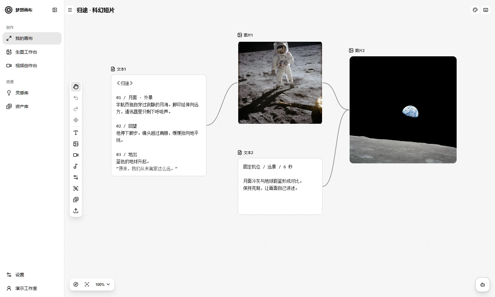

<div align="center">

<picture>
  <source media="(prefers-color-scheme: dark)" srcset="web/public/images/logo-on-dark.svg" />
  
</picture>

# 梦想画布 · Dream Canvas

**想象不设边界 · 创作，自由展开**

面向影视、短剧与 AI 视频创作的自托管无限画布

<p>
  
  
  
  
  
  
</p>

<p>
  <a href="#核心功能">核心功能</a> ·
  <a href="#快速开始">快速开始</a> ·
  <a href="#部署说明">部署说明</a> ·
  <a href="#本地开发">本地开发</a> ·
  <a href="CHANGELOG.md">更新日志</a>
</p>

<picture>
  <source media="(prefers-color-scheme: dark)" srcset="web/public/images/landing/canvas-zh-dark.webp" />
  <source media="(prefers-color-scheme: light)" srcset="web/public/images/landing/canvas-zh-light.webp" />
  
</picture>

<sub>实际界面截图，使用《归途》演示剧本与公开参考素材。<a href="web/public/images/landing/README.md">截图与素材说明</a></sub>

</div>

梦想画布把剧本、人物设定、场景参考、分镜与生成结果放在同一张无限画布上。通过节点和连线整理故事，也可以进入独立的生图工作台、视频创作台，或让助手协助操作项目。

项目面向个人与小团队自托管：前端负责交互，Go 服务统一管理账号、项目、私有资产、模型渠道、生成任务和助手执行，数据保存在自己的服务器上。界面支持中文、英文与黑白中性浅深主题。

> 项目仍在持续开发与验收。文本、图片模型接入已通过用户实际测试；视频、TTS、助手工具调用、安全、任务恢复及性能等专项仍需独立验收。代码实施与实际验收进度见 [CHANGELOG](CHANGELOG.md)。

## 核心功能

| 功能 | 说明 |
| --- | --- |
| 无限画布 | 用文本、图片、视频、音频、生成配置和组节点组织创作；支持节点连线、自动保存、撤销 / 重做及项目导入导出。内置便利贴、3D 全景和超分节点。 |
| 生图与视频工作台 | 提示词、参考素材、模型参数和生成记录集中编辑；图片保持原始比例展示，成品可下载或手动加入资产库。支持的创作模式与参数由所选模型的接口插件决定。 |
| 私有资产库 | 统一管理文本、图片、视频和音频，跨项目复用素材；媒体原件保存在服务端，可后台同步至私有对象存储，分别显示保存与同步状态。 |
| 灵感库 | 在同一个入口管理文本、图片、视频提示词与技能；包含项目内置内容及账号个人内容，支持搜索、筛选与在创作中选用。 |
| 助手与 MCP | 全局助手通过业务工具整理项目、编辑节点、查找素材及提交生成任务；外部客户端通过 Streamable HTTP MCP 访问同一业务能力，按令牌限制项目和操作范围。 |
| 渠道与接口插件 | 按「渠道 → 模型」配置和选择模型；内置 OpenAI 兼容文本、图片、TTS、视频接口及 Seedance、MiniMax 视频适配，自建 JavaScript 接口插件可配置输入、保存草稿与发布版本。 |
| 任务与用量 | 在「设置 → 任务与用量」查看任务阶段、结果与待处理状态，以及按时间、项目、渠道、模型和类型筛选的调用次数；任务切页后继续在服务端处理。 |
| 账号与站点管理 | 管理员创建和停用账号，配置站点开关、并发、接口插件运行时限与资源上限，以及渠道、对象存储、节点启停与日志；项目、资产和助手历史默认按用户隔离。 |

接口插件在服务端执行，画布节点插件在浏览器执行，两者的运行边界不同。节点扩展约定见 [节点插件说明](plugins/canvas/README.md)。

## 快速开始

推荐使用 **Docker Compose**，镜像已包含前端、后端和 FFmpeg，支持 `amd64` / `arm64`，无需单独安装 Go、Node.js 或数据库。请先安装 Docker 和 Docker Compose v2.24.4+。

### 1. 下载并创建管理员

```bash
git clone https://github.com/qgming/dream-canvas.git
cd dream-canvas
docker compose pull
docker compose run --rm --no-deps dream-canvas -data /data -init-admin admin
```

按终端提示设置管理员密码，输入时不会显示字符。**初始化仅在首次部署时执行**，账号为 `admin`，没有默认密码。

### 2. 启动应用

```bash
docker compose up -d
```

打开 [http://localhost:8080](http://localhost:8080)，点击右上角「登录」，使用刚创建的管理员账号。默认仅允许部署机器本机访问；在服务器部署后，通过下方 [HTTPS 与域名](#https-与域名) 配置远程访问。请使用支持 Web Locks 的现代浏览器，通过 `localhost` 或 HTTPS 访问。

### 3. 添加模型，开始创作

1. 在「设置 → 渠道与模型」添加渠道，填写名称、完整 API URL 和 KEY。**URL 不会自动补 `/v1`**。
2. 添加模型，选择类型与接口插件，保存后即可在画布或工作台使用。助手需选择支持工具调用的文本模型；非标准接口可在「设置 → 接口插件」导入或编写插件。
3. 按需在「设置 → 对象存储」配置私有存储，供需要公网 HTTPS 素材的模型使用；其他账号在「设置 → 账号管理」创建。

## 部署说明

### HTTPS 与域名

远程使用时，将域名解析到服务器，开放 TCP 80 / 443 端口，并在项目目录创建 `.env`：

```dotenv
DOMAIN=canvas.example.com
```

替换为自己的域名；已有 `.env` 时只补充这一项，保留原配置。然后在项目目录执行：

```bash
docker compose down
docker compose -f compose.yaml -f compose.https.yaml up -d
```

通过 `https://你的域名` 访问，Caddy 自动申请和续期证书。切换过程保留应用数据；HTTPS 模式下，后续更新、日志、停止和备份命令中的 `docker compose` 均替换为 `docker compose -f compose.yaml -f compose.https.yaml`。

<details>
<summary>已有 Nginx / Caddy 反向代理</summary>

可继续使用基础 [compose.yaml](compose.yaml)，将网站反向代理到宿主机的 `127.0.0.1:8080`，保留原始 `Host`、覆盖 `X-Forwarded-Proto` 并关闭 SSE 响应缓冲。

宿主机代理经过 Docker 端口映射时，应用看到的来源通常是桥接网关，可在部署机器上查询：

```bash
docker inspect "$(docker compose ps -q dream-canvas)" --format '{{range .NetworkSettings.Networks}}{{.Gateway}}{{println}}{{end}}'
```

核对代理实际使用的网关，在 `.env` 设置 `DREAM_CANVAS_TRUSTED_PROXIES=实际网关IP/32`（IPv6 用 `/128`），执行 `docker compose up -d --force-recreate`。仅信任实际代理来源，保持 HTTP 端口绑定 `127.0.0.1`，以便服务正确识别 HTTPS 并设置安全会话 Cookie。

</details>

### 更新版本

更新前先备份数据，再在项目目录执行：

```bash
docker compose pull
docker compose up -d
```

默认使用 `latest`，只随正式版本发布更新。需要固定版本时，在 `.env` 将 `DREAM_CANVAS_TAG` 设为已发布的标签（例如 0.1.4 发布后可设置 `DREAM_CANVAS_TAG=v0.1.4`）；之后升级先改为目标版本，再执行上述命令。**更新时不需要重新初始化管理员**。

常用管理命令：

| 操作 | 命令 |
| --- | --- |
| 查看运行状态 | `docker compose ps` |
| 查看日志 | `docker compose logs -f --tail=100 dream-canvas` |
| 停止应用 | `docker compose stop` |

其他可选配置见 [.env.example](.env.example)：端口、时区和镜像版本按需设置即可。首次部署后保持 `COMPOSE_PROJECT_NAME` 不变，避免切换到另一份数据卷。

### 数据与备份

应用数据默认保存在 Docker 数据卷 **`dream-canvas_data`**，容器内路径为 `/data`，包含数据库、媒体、日志和凭据解密密钥 `credentials.key`。更新或重建容器会保留这些数据；**不要使用 `docker compose down -v` 删除数据卷**。

完整备份需先停止服务，再备份整个数据卷。设置中的「数据备份」只导出当前账号的资产库，对象存储同步也不能代替整站备份。

<details>
<summary>展开完整备份与恢复命令</summary>

以下命令在项目目录执行。每次备份使用不同的文件名，保留 `.env` 和当时使用的镜像版本。

**备份：**

```bash
mkdir -p backups
docker compose stop
docker compose run --rm --no-deps --user 0:0 --entrypoint tar --volume "${PWD}/backups:/backup" dream-canvas -czpf /backup/dream-canvas-data.tar.gz -C /data .
docker compose up -d
```

PowerShell 将建目录命令替换为 `New-Item -ItemType Directory -Force backups`。备份包含私有媒体与解密密钥，请妥善保存。

**恢复：**先停止所有使用目标数据卷的实例。使用新目录保存同一份 Compose 配置和备份，将 `.env` 中的 `COMPOSE_PROJECT_NAME` 改为未使用过的名称，并将 `DREAM_CANVAS_TAG` 设置为备份对应的版本，以创建独立空卷。

```bash
docker compose run --rm --no-deps --user 0:0 --entrypoint tar --volume "${PWD}/backups:/backup:ro" dream-canvas -xzpf /backup/dream-canvas-data.tar.gz -C /data
docker compose up -d
```

恢复目标必须为空，不能向已有数据卷直接覆盖解压。数据库与 `credentials.key` 需成套恢复；回退镜像不会回退数据库。使用内置 HTTPS 时，上述命令也需带两个 `-f` 参数，Caddy 证书保存在独立的 `caddy_data` / `caddy_config` 卷。

</details>

## 本地开发

<details>
<summary>展开源码开发与构建方式</summary>

需要 **Go 1.25+、Node.js 22.12+ 与 npm**，并将 **ffmpeg、ffprobe** 安装到后端环境的 `PATH` 中。

在克隆后的项目目录，先启动后端：

```bash
cd server
go mod download
go run ./cmd/server -init-admin admin  # 仅首次创建管理员
go run ./cmd/server
```

另开终端，在项目目录启动前端：

```bash
cd web
npm ci
npm run dev
```

访问 [http://localhost:3000](http://localhost:3000)。Vite 提供热更新并代理 `/api`、`/mcp`；后端监听 `127.0.0.1:8080`，数据保存在 `server/data/`。

**构建后直接运行：**

```bash
cd web
npm ci
npm run build
cd ../server
go build -o dream-canvas-server ./cmd/server
./dream-canvas-server -data ./data -web ../web/dist -listen 127.0.0.1:8080
```

Go 服务直接提供静态页面，部署机器仍需安装 ffmpeg、ffprobe。全新数据目录先执行 `./dream-canvas-server -data ./data -init-admin admin` 创建管理员，再启动服务。升级时保留完整数据目录并同步更新前后端。

**修改源码后构建 Docker 镜像：**

```bash
docker compose -f compose.yaml -f compose.build.yaml build --pull
docker compose -f compose.yaml -f compose.build.yaml run --rm --no-deps dream-canvas -data /data -init-admin admin  # 仅首次
docker compose -f compose.yaml -f compose.build.yaml up -d
```

后续管理命令同样携带两个 `-f` 参数；需要 HTTPS 时再追加 `-f compose.https.yaml`。镜像构建配置见 [Dockerfile](Dockerfile)，发布配置见 [打包工作流](.github/workflows/docker.yml)。

</details>

## 开源协议

梦想画布由 **qgming** 设计、开发与维护，项目原创及新增内容署名 qgming。

梦想画布项目部分理念和实现方式参考 [basketikun/infinite-canvas](https://github.com/basketikun/infinite-canvas) 和 [DEEIX-Chat](https://github.com/DEEIX-AI/DEEIX-Chat)两个开源项目

项目采用 [MIT License](LICENSE)，版权署名为 `Copyright (c) 2026 qgming`，同时保留上游原始版权声明。第三方组件遵循各自许可证：QuickJS WASM 绑定的来源与局部修改见 [第三方说明](server/third_party/qjs/NOTICE.md)；首页 Glyph 背景所附的 **MIT + Commons Clause** 条款见 [Animate UI 许可证](web/src/components/animate-ui/LICENSE.md)。
